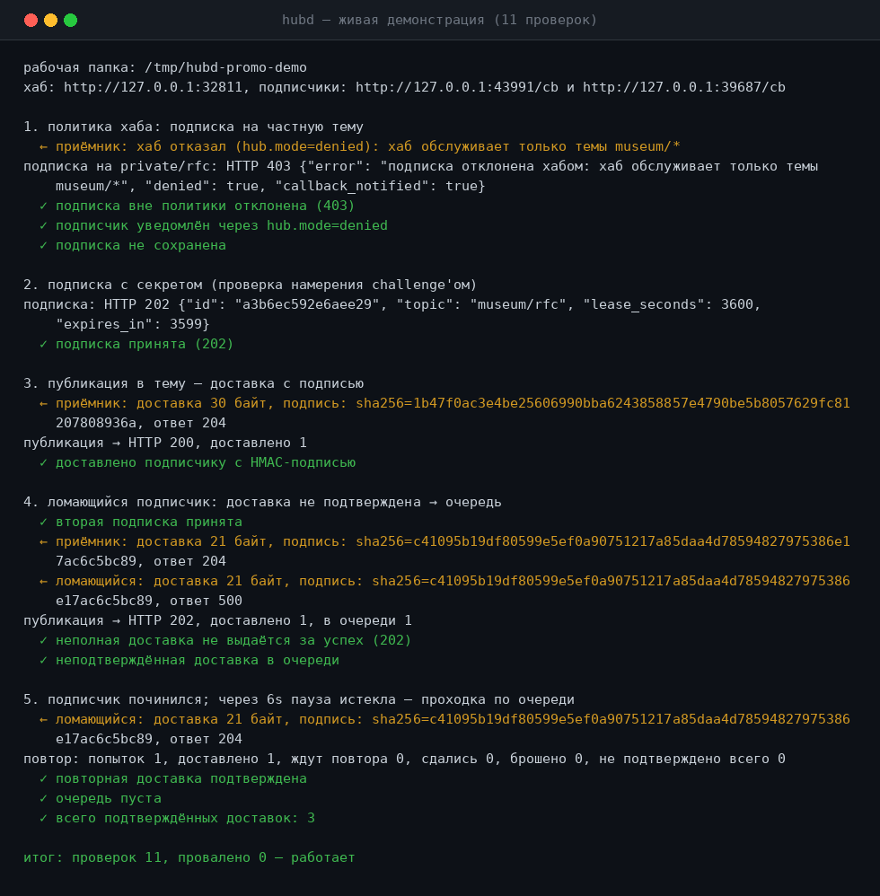
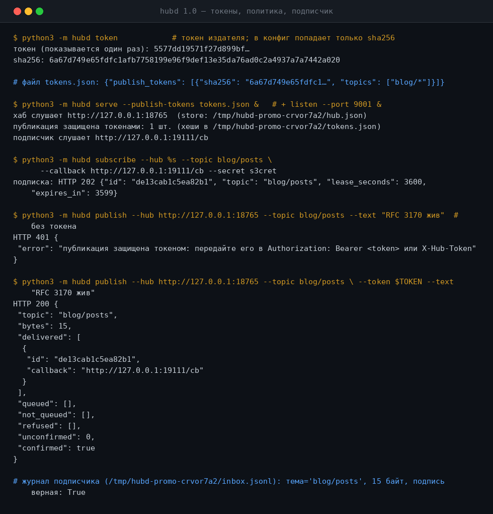

# hubd

### Хватит опрашивать. Подпишитесь один раз.

**hubd — хаб подписок, сканер источников и WebSub-клиент в одном пакете без зависимостей.
Издатель публикует в тему, не зная подписчиков, подписка — аренда, а неподтверждённая доставка —
это состояние: она повторяется с растущей паузой или честно отказывает, но не теряется молча.**

[English](README.md) · [**Русский**](README.ru.md)

---

## Что такое hubd?

Один Python-пакет (3.11+, **только стандартная библиотека** — `pip install` здесь не нужен
и не появится) для обеих сторон истории «реагируем на изменения» — для скриптов, ботов,
агентов, домашнего cron, чего угодно:

* 📡 **Хаб** — subscribe / unsubscribe / publish поверх HTTP с дисциплиной WebSub:
  проверка намерения challenge'ом, `hub.mode=denied`, `X-Hub-Signature: sha256=…`;
* ⏳ **Контракт доставки** — неподтверждённая доставка не тишина: очередь повторов на диске
  с экспоненциальной паузой; когда попытки исчерпаны, подписка помечается `degraded`, и хаб
  отвечает `503` **с причиной**;
* 🔍 **Сканер** — условный GET (`ETag` / `If-Modified-Since`), дедупликация по sha256,
  вежливые 1 запрос/сек на хост; «болтливые» источники без валидаторов подавляются видимо;
* 🔌 **Адаптеры** — изменившееся тело — ещё не событие: `plain` публикует тело целиком,
  `json` — значение по пути `json_path` (дедупликация **по значению**, а не по шумному телу),
  `rss`/`atom` — по записи;
* 🧩 **Плагины** — положите `.py`-файлы в каталог: свои адаптеры (`extract`) и фильтры
  событий (`transform`) без правки ядра;
* 🛰 **Клиентская сторона WebSub** — `discover` читает хаб, объявленный страницей (`Link`-заголовок,
  `atom:link`), `listen` поднимает сервер обратного вызова (challenge эхом, доставки с подписью,
  JSONL-журнал), `subscribe` делает рукопожатие;
* 🔐 **Опциональное укрепление** — токены издателя (в конфиге только sha256-хеши, scope по темам),
  политики тем (`allow`/`deny`), HTTPS в два флага;
* 🧪 **Проверено запуском** — 153 теста, живая демонстрация на 11 проверок, честные коды
  возврата для cron.

## Откуда это взялось

hubd вырос из дайджеста [«RFC-кладбище»](https://kostyk348.github.io/lost-tech-museum/digests/rfc-graveyard/)
[Музея потерянных идей](https://github.com/kostyk348/lost-tech-museum) — не «по мотивам», а по записям архива:

| запись архива (`id`) | что взято |
| --- | --- |
| `ipmulticast` | адрес группы вместо списка получателей: издатель публикует в **тему** и не знает подписчиков |
| `pubsubhubbub` | pubsub поверх HTTP: `hub.topic` / `hub.callback` / `hub.secret`, проверка намерения challenge'ом |
| `rsvp`, `atmip` | контракт доставки: подписка — аренда, неподтверждённая доставка не теряется, а честно повторяется и в пределе честно отказывает |
| `time868` | типовой объект слежения: «RFC 868 — формально стандарт, де-факто музей» |

Дисциплина протокола совместима по духу с [WebSub (W3C)](https://www.w3.org/TR/websub/):
challenge, 404 как отказ подписчика («не хочу»), `hub.mode=denied` как сообщение **хаба**
подписчику, `X-Hub-Signature: sha256=…` по секрету подписки. Музей остаётся одним из примеров
списка наблюдения (`python -m hubd watchlist --museum …`) — но не требованием: с v1.0.0 ядро
предметно-независимо.

## Быстрый старт

```
# 1. тесты — ноль зависимостей, только stdlib
python3 -m unittest discover -s tests -t .          # Ran 153 tests ... OK

# 2. демонстрация целиком: хаб, два подписчика, политика отказа, очередь повторов
python3 -m hubd demo                                 # итог: проверок 11, провалено 0

# 3. хаб (добавьте --tls-cert/--tls-key для https, --publish-tokens для авторизации)
python3 -m hubd serve --store data/hub.json --port 8765

# 4. сканер: сбор и доставка разведены
python3 -m hubd scan --watchlist watchlist.json --queue data/candidates.jsonl --once
python3 -m hubd scan --watchlist watchlist.json --queue data/candidates.jsonl \
                    --publish --hub http://127.0.0.1:8765 --every 300
```

Список наблюдения — просто JSON, любой набор источников с темами:

```
{"sources": [
  {"url": "https://blog.example/feed.xml",      "topic": "blog",        "adapter": "rss"},
  {"url": "https://api.example.com/.../latest", "topic": "app/releases",
   "adapter": "json", "json_path": "tag_name"},
  {"url": "https://page.example.com/status",    "topic": "page/status"}
]}
```

## Скриншоты (реальный вывод, loopback)

| Демонстрация на 11 проверок | Токены, политика, подписчик |
| --- | --- |
|  |  |

## HTTP-API хаба

| метод | путь | что делает |
| --- | --- | --- |
| `POST` | `/subscribe` | `hub.mode=subscribe`, `hub.topic`, `hub.callback`, `hub.lease_seconds`, `hub.secret`. Отвечает **202** и только после проверки намерения (challenge, который подписчик обязан вернуть эхом) |
| `POST` | `/unsubscribe` | `hub.mode=unsubscribe`, `hub.topic`, `hub.callback` → 202; вместе с подпиской снимается её очередь |
| `POST` | `/publish?topic=…` | тело — полезная нагрузка. Публикация **в тему**: издатель не перечисляет подписчиков |
| `POST` | `/retry` | одна проходка по очереди неподтверждённых доставок (её же крутит `serve --retry-interval`) |
| `GET` | `/subscriptions` | подписки без секретов: аренда, доставки, провалы, `pending`, общий `unconfirmed` |
| `GET` | `/journal` | последние 50 записей журнала (кому и что доставлено) |
| `GET` | `/healthz` | `ok`, число подписок, `unconfirmed` |

Коды ответа на публикацию — честный итог, а не «успех вообще»:

| код | смысл |
| --- | --- |
| `200` | доставлено **всем** активным подписчикам |
| `202` | принято, но что-то ещё не подтверждено — уйдёт в повтор (`unconfirmed` в теле) |
| `502` | доставить не смогли и повторить не сможем (тело больше очереди) |
| `503` | все подписчики нарушили контракт доставки: `refused` с причиной |

## Контракт доставки: «не подтверждено» — это состояние, а не тишина

* доставка, которую подписчик не подтвердил, кладётся в очередь с задержкой **5 с**, дальше
  пауза удваивается до 1 часа (`backoff_seconds`);
* повторов на сообщение — до 8 (`max_attempts`);
* очередь лежит на диске (в том же JSON, что подписки) и переживает перезапуск;
* тело больше 256 КБ в очередь не кладём: вместо тихой потери — `502` и причина;
* когда попытки исчерпаны, подписка помечается `degraded` с причиной, и хаб дальше **честно
  отказывает** (`503`), а не делает вид, что доставил;
* аренда кончилась или подписку сняли — очередь этой подписки выбрасывается: стучаться некуда;
* сколько доставок хаб взял на себя и ещё не подтвердил, видно в `/healthz`, `/subscriptions`,
  `hubd subs` и в отчёте `hubd retry`.

## Сканер и адаптеры

Сканер отвечает на вопрос «изменился ли адрес?» (условный GET, дедупликация по sha256,
вежливость, честные строки ошибок для cron с `check --fail-on-error`). Адаптер отвечает,
что это значит:

| адаптер | поле | событие |
| --- | --- | --- |
| `plain` | *(по умолчанию)* | тело ответа целиком — ровно поведение до 1.0 |
| `json` | `json_path: "tag_name"` | значение по пути; дедупликация по значению — API, добавляющий в ответ счётчики, фантомных событий не создаёт |
| `rss` / `atom` | `max_entries` (20), `per_entry` | событие на каждую новую или изменённую запись; первый проход сеет состояние и не издаёт событий |

Первый обход любого адаптера — знакомство, а не новость. Источник без `ETag`/`Last-Modified`
считается «болтливым»: события подавляются, пока в списке наблюдения не сказано
`"allow_volatile": true` — это видимое решение, а не молчаливая потеря.

## Плагины

```
# plugins/drop_bots.py
def transform(event, item):
    return event if "bot" not in event["topic"] else None   # None = отбросить, видимо
```

```
python3 -m hubd scan --watchlist watchlist.json --plugins plugins --once
```

`extract(item, result, state)` заменяет адаптер для источников с `"plugin": "имя"`;
`transform(event, item)` переписывает или отбрасывает события после любого адаптера.
Сбоящий плагин — видимая строка, а не сломанный обход. Плагины — доверенный код:
они исполняются с правами hubd.

## Клиентская сторона (WebSub)

```
python3 -m hubd listen --port 9001 --secret "rfc/*=s3cret"      # сервер обратного вызова, JSONL-журнал
python3 -m hubd discover --url https://example.org/feed         # найти объявленный хаб
python3 -m hubd discover --url https://example.org/feed --subscribe \
                         --callback http://127.0.0.1:9001/cb    # …и подписаться на него
python3 -m hubd token                                           # токен издателя + его sha256
```

`listen` возвращает challenge эхом, пишет в журнал `hub.mode=denied` с причиной и складывает
каждую доставку в JSONL — доставка с неверной подписью сохраняется с флагом
`signature_valid: false`, потому что строка в журнале честнее тишины.

## Безопасность

* **токены издателя** — `serve --publish-tokens tokens.json`: в файле только sha256-хеши
  (токен открытым текстом — ошибка чтения конфига), токены ограничиваются шаблонами тем
  (`"topics": ["rfc/*"]`), неверный токен → `401` с причиной;
* **политики тем** — `serve --policy policy.json` с `{"allow": [...], "deny": [...]}`;
  deny выигрывает у allow; `--topic-prefix` остался как сахар;
* **TLS** — `serve --tls-cert cert.pem --tls-key key.pem`: тот же протокол, https на проводе;
* по умолчанию хаб открыт — это задокументированный локальный режим, а не спрятанный.

## Что проверено запуском

| проверка | вывод |
| --- | --- |
| `python3 -m unittest discover -s tests -t .` | `Ran 153 tests … OK` |
| `python3 -m hubd demo` | `итог: проверок 11, провалено 0 — работает` |
| TLS-тест | поднимает реальный https-сервер с самоподписанным сертификатом |
| тесты токенов | `401` без токена, scoped-`401` на чужой теме, `200` с правильным |
| тесты адаптеров | ленты издают только новые записи; шумный API со стабильным значением не издаёт ничего |

## Ограничения (честный список)

См. [LIMITATIONS.md](LIMITATIONS.md). Главное: доставка in-process без аутентификации издателя
по умолчанию, хранилище — один JSON-файл, плагины — доверенный код, discovery для HTML —
по регулярным выражениям, хаб — один процесс на одном хранилище.

## Провенанс и соседи

* музей (только чтение): [lost-tech-museum](https://github.com/kostyk348/lost-tech-museum),
  дайджест [rfc-graveyard](https://kostyk348.github.io/lost-tech-museum/digests/rfc-graveyard/);
* записи архива, из которых собран hubd: `ipmulticast`, `pubsubhubbub`, `rsvp`, `atmip`, `time868`;
* хорошо сочетается с [MIME-OS / EMLBox](https://github.com/kostyk348/mime-os) — события,
  которые доставляет hubd, это контейнеры, которые mime-os умеет хранить; и с
  [EAFAR](https://github.com/kostyk348/eafar), когда разреженный мир должен узнавать об изменениях.

## Contributing

PR приветствуются — см. [CONTRIBUTING.md](CONTRIBUTING.md). Изменения фиксируются в
[CHANGELOG.md](CHANGELOG.md).

## Лицензия

Apache-2.0 — см. [LICENSE](LICENSE).

**hubd** — публикуйте в тему, а не в список.
